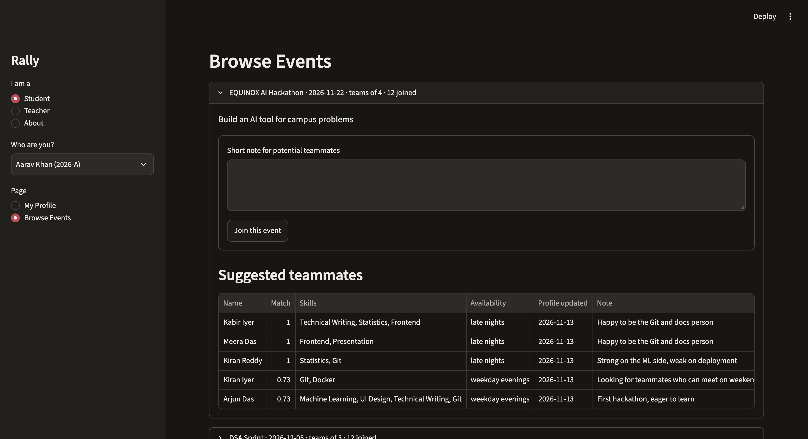

# Rally

Rally is a Streamlit app where teachers post Zenith events and students find teammates for them.



## What it does

- **Teachers** create events with a title, description, team size, and date.
- **Students** build one profile (skills, languages, availability) and join events with a short note.
- **Rally suggests teammates** for each event, based on who complements your skills and when you are free.

## Run it

You need Python 3.13.

```bash
git clone [<repo-url>](https://github.com/rishianandsingh/Rally.git) && cd Rally
python3.13 -m venv .venv
source .venv/bin/activate
pip install -r requirements.txt
python seed.py
streamlit run app.py
```

`seed.py` fills the database with fake demo data (28 students, 3 events). Run it once. The app opens in your browser at http://localhost:8501.

## Teacher PIN

Creating events is protected by a PIN. Set it in your terminal before starting the app:

```bash
export RALLY_TEACHER_PIN=1234
```

Rally reads it from the `RALLY_TEACHER_PIN` environment variable (see `config.py`). If it isn't set, the app shows an error telling you to set it.

Use the sidebar to switch between Student and Teacher.

## How matching works

1. Every pair of students gets a score. It goes up when their skills complement each other and when their availability overlaps.
2. Rally builds teams greedily. It takes the best-scoring students first and fills each team up to the event's `team_size`.
3. Matching only uses the structured profile fields. The free-text event note is shown but not parsed.

## Run the tests

```bash
pytest
```

## Known limitations

- No real login. Teachers use a PIN only. See [Replace PIN with proper role-based authentication]([<issue-url>](https://github.com/rishianandsingh/Rally/issues/1)).
- Events can be created and listed, but not edited or deleted.
- No notifications.
